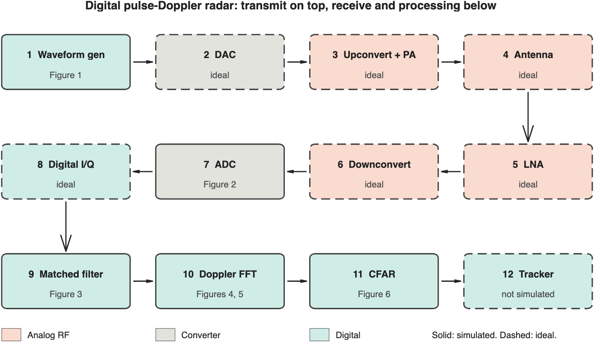
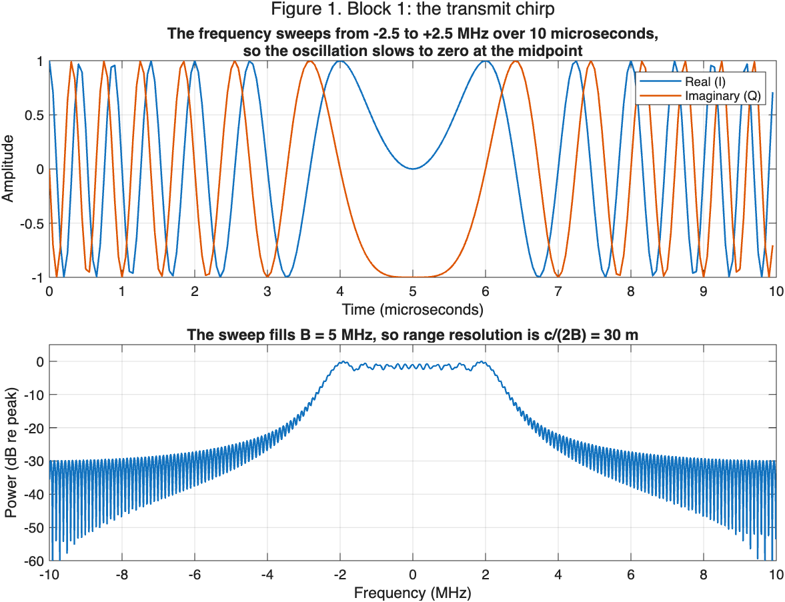
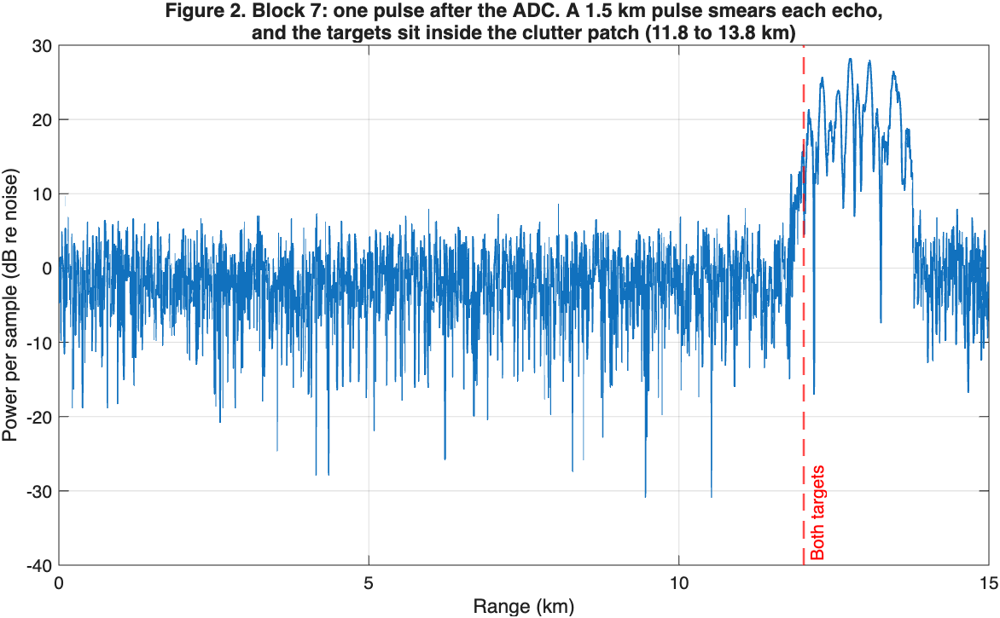
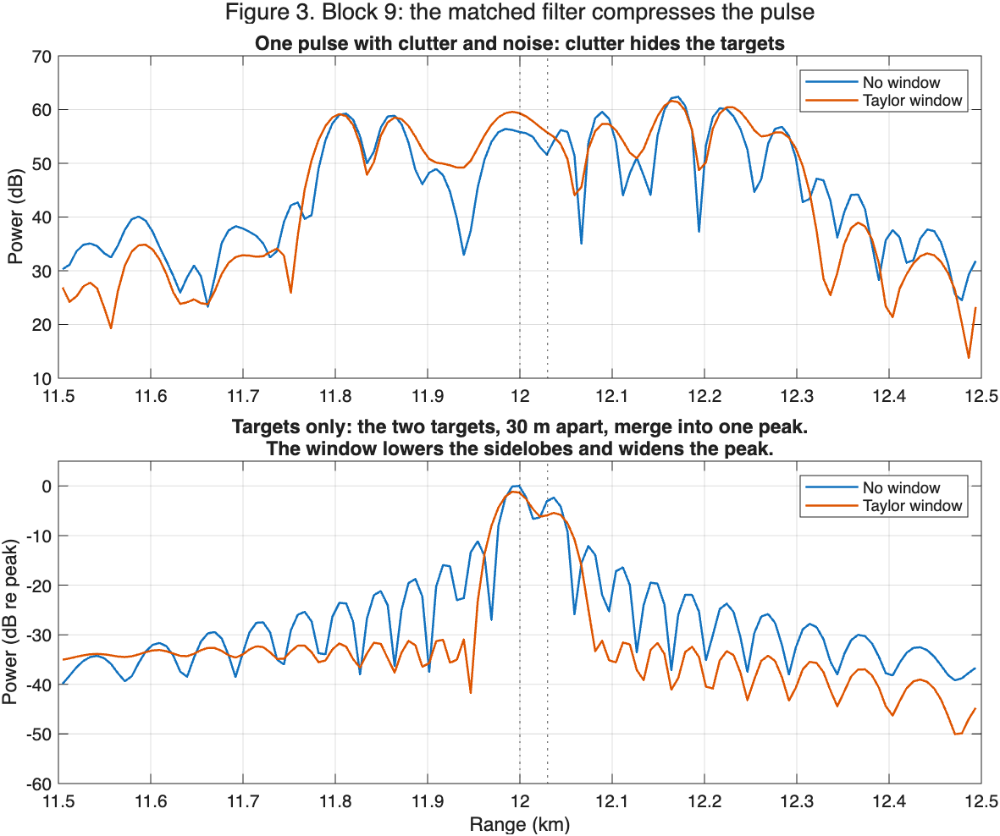
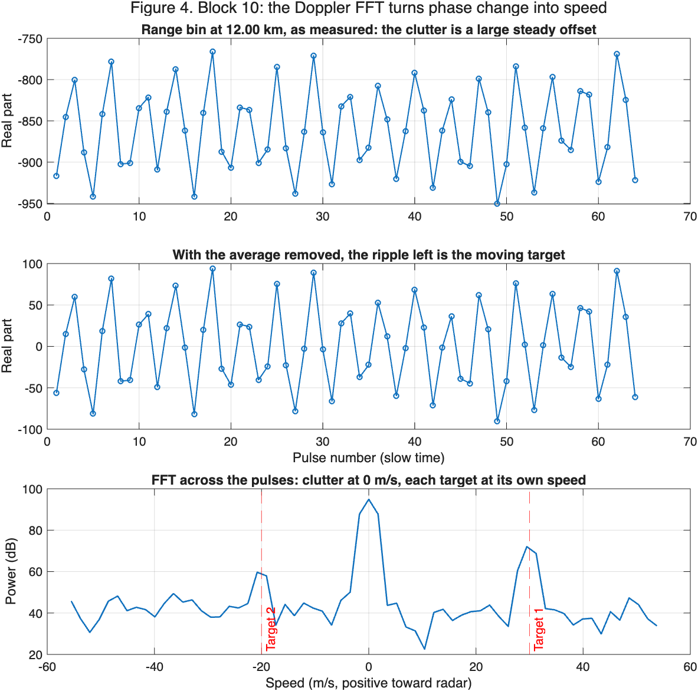
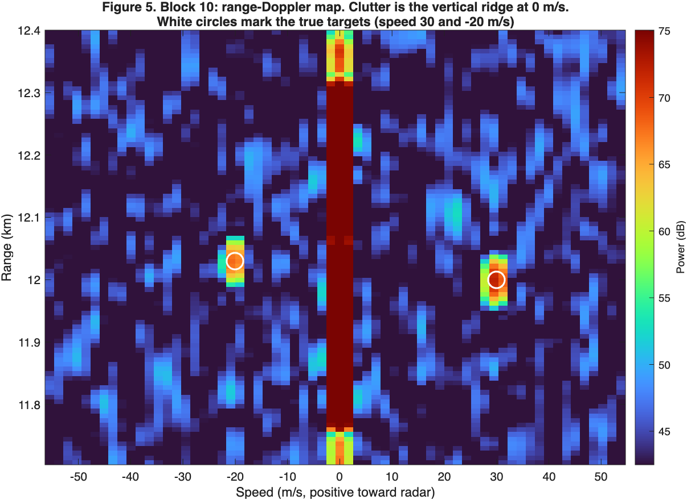
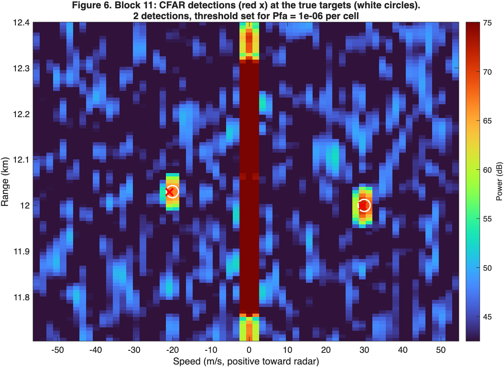

# radar_explainer

A MATLAB walkthrough of a digital pulse-Doppler radar for new engineers. One
script simulates two moving targets inside a stationary clutter patch, runs the
echoes through each digital block of the radar, and saves one figure per stage.



## Run it

You need MATLAB R2025b with the Signal Processing Toolbox and the Phased Array
System Toolbox. The code is verified in R2025b only.

```matlab
results = radar_explainer_rev1;
```

The script prints the SNR at each stage and the CFAR detections, checks the
results against theory, and writes the figures to `figures/`. To run without
opening figure windows, use `radar_explainer_rev1(show_figures=false)`.

| File | Purpose |
| --- | --- |
| `radar_explainer_rev1.m` | The walkthrough. Each block of the diagram has a commented section. |
| `test_radar_explainer_rev1.m` | Unit tests. Run with `runtests("test_radar_explainer_rev1")`. |
| `figures/` | The figures that the default run produces. |

## The scenario

The default scenario uses demo values chosen to make each block easy to see.
They aren't values from a fielded radar. Change them in `scenario_parameters_rev1`.

- A 2.7 GHz radar sends a 10 µs chirp with 5 MHz of bandwidth, at a PRF of 2 kHz.
- Target 1 is at 12.00 km, closing at 30 m/s. Target 2 is at 12.03 km, moving
  away at 20 m/s. Their per-sample SNRs are -10 dB and -13 dB.
- A stationary clutter patch covers 11.8 to 12.3 km. It is 25 dB above the
  noise in each sample, so it is far stronger than either target.
- The radar processes 64 pulses as one coherent dwell.

## What each block does

| Block | What it does | Figure |
| --- | --- | --- |
| 1. Waveform generator | Makes the linear FM chirp. A long pulse carries energy, and the sweep sets the bandwidth. | 1 |
| 2-6. Analog RF chain | Not simulated. The code works at complex baseband. | None |
| 7. ADC | Rounds each I and Q sample to an integer. | 2 |
| 8. Digital I/Q | The samples are already complex baseband, so this block needs no code. | None |
| 9. Matched filter | Slides a copy of the pulse across the echo and sums the products. This squeezes the long pulse into a short one. | 3 |
| 10. Doppler FFT | Runs an FFT across the pulses in each range bin to measure speed. | 4, 5 |
| 11. CFAR detector | Sets a threshold from the cells around each cell and reports detections. | 6 |
| 12. Tracker | Not simulated. | None |

## Walk through the figures

### Figure 1: the transmit chirp

The frequency sweeps across 5 MHz during the pulse. That bandwidth sets the
range resolution, c/(2B), at 30 m.



### Figure 2: one received pulse

The 10 µs pulse is 1.5 km long, so each echo smears over 1.5 km. Both targets
sit inside the clutter patch, and you can't see them.



### Figure 3: the matched filter

In the top plot, the clutter hides the targets in a single pulse. In the bottom
plot, with only the targets present, the filter squeezes each echo into a narrow
peak. The two targets are 30 m apart, so they merge into one peak. The Taylor
window lowers the sidelobes and widens the peak.



### Figure 4: the Doppler FFT in one range bin

In the first plot, the clutter is a large steady offset. In the second plot,
removing the average leaves the ripple from the moving target. The third plot
shows that the FFT turns that ripple into a peak at the target's speed. Clutter
sits at 0 m/s.



### Figure 5: the range-Doppler map

Range alone can't separate the two targets, but speed can. The clutter is the
ridge at 0 m/s.



### Figure 6: CFAR detections

The detector reports both targets and ignores the clutter ridge.



## Results from the default run

| Quantity | Value |
| --- | --- |
| Target 1 SNR per sample, before processing | -10.0 dB |
| After the matched filter (theory, 10 log10 of 200 samples) | 13.0 dB |
| After the Doppler FFT (measured) | 28.2 dB |
| Detection 1 | 11,999 m, 29.5 m/s (truth: 12,000 m, 30 m/s) |
| Detection 2 | 12,029 m, -20.8 m/s (truth: 12,030 m, -20 m/s) |

The code checks five results against theory, and all five pass:

- The matched-filter SNR gain is 23.0 dB. Theory gives 23.0 dB.
- The compressed pulse peaks at the sample where theory puts it.
- The compressed pulse is 26.4 m wide at -3 dB. Theory gives 26.6 m.
- Both targets are detected, with no false alarms.

## Try it

Change a value in `scenario_parameters_rev1`, then run with `run_checks=false`.
The theory checks assume the default scenario, so they can fail when you change it.
Each result below comes from a run of the code.

- **Lower the ADC resolution.** Run
  `radar_explainer_rev1(adc_bits=2, run_checks=false)`. The quantization noise
  rises from 3e-5 at 12 bits to 36 at 2 bits, where the receiver noise is 1. The
  SNR after the Doppler FFT falls from 28.2 dB to 24.3 dB, and both targets are
  still detected.
- **Bring the targets closer in range.** Set target 2 to 12,010 m. The detector
  still reports two targets, at 11,999 and 12,007 m, because their speeds differ.
- **Give both targets the same speed.** Set both speeds to 30 m/s. Now only range
  can separate them. The detector reports two peaks, but they sit 45 m apart
  instead of 30 m, at 11,992 and 12,037 m.
- **Lower the PRF.** Set `prf` to 1e3. The unambiguous speed falls to 27.8 m/s.
  The 30 m/s target folds to about -25.5 m/s, outside the Doppler cells that the
  CFAR tests, so the detector reports only target 2.
- **Narrow the bandwidth.** Set `bandwidth` to 0.1e6. The range resolution grows
  to 1.5 km, the clutter and targets no longer separate in range, and the
  detector finds nothing.

## What the code leaves out

- The analog RF chain: the mixers, amplifiers, and antenna.
- Range migration. The targets move about 1 m during the dwell, which is less
  than one 7.5 m range cell.
- Doppler spread in the clutter. The clutter is perfectly stationary.
- Doppler ambiguity handling. A target faster than the unambiguous speed aliases.
- Tracking. The walkthrough stops at detections.

## Tests

The tests check the output shape, the detections, the matched-filter gain against
an independent value (10 log10 of 200 samples), reproducibility, the saved
figures, and the input validation. To confirm that the tests can fail, a copy of
the code with the two-way Doppler factor removed fails 5 of the 11 tests.
